# hana-zero — 硅基生命体 Agent 系统架构设计

> **版本**：V1.0（设计讨论稿）  
> **定位**：具备多模态感知、自主决策、工具操作、长期记忆和跨设备行动能力的个人硅基生命体  
> **范围**：架构与技术方案设计；不包含具体工程实现  
> **绘图说明**：本文采用 Mermaid 图表；GitHub、VS Code 和支持 Mermaid 的 Markdown 阅读器可直接渲染。

---

## 一、产品构想：hana-zero 是什么？

hana-zero 不应该只是一个套了拟人化 UI 的 ChatGPT，也不应该只是另一个 Claude Code。真正值得做的方向，是让 Agent 从「被动响应一次请求的程序」，演进为「能够感知环境、保持状态、主动行动、持续完成任务的运行时系统」。

### 1.1 四大能力

| 能力 | 作用 | 输入与输出示例 |
|---|---|---|
| **Perception 感知** | 获取外界信息 | 摄像头、截图、屏幕、麦克风、环境事件 |
| **Cognition 认知** | 形成决策和上下文 | 推理、规划、记忆、目标管理 |
| **Action 行动** | 对环境采取行动 | Tool Calling、MCP、Skills、设备操作 |
| **Autonomy 自主** | 跨时间持续推进目标 | 定时触发、外部事件、后台监控、子 Agent 协作 |

### 1.2 三种产品模式

| 模式 | 定义 | 场景 |
|---|---|---|
| Companion | 陪伴交互 | 实时语音、屏幕观察、自然对话 |
| Copilot | 协助执行 | 分析日志、整理资料、运行工具 |
| Autonomous | 自主任务 | 定时检查、研究课题、持续追踪结果 |

三种模式应属于**同一套 hana-zero 身份的不同运行模式**，共享记忆、能力和权限体系，而不是三个互相孤立的机器人。

### 1.3 核心设计原则

1. **身份和执行实例解耦**：同一个 hana-zero 实例可以在不同设备上被访问，但 Agent Run 是按需创建与销毁的。
2. **Agent 决策和可靠执行分离**：Agent 负责下一步行动，Workflow 负责跨时间、故障与依赖的执行可靠性。
3. **模型不直接操作系统**：模型提出意图，Runtime 验证权限后通过能力适配器执行。
4. **默认可观测**：所有模型、工具、工作流和设备调用必须能够追踪、归因、分析。
5. **优先模块化单体**：逻辑模块边界清晰，部署不必一开始微服务化。
6. **长期存在不等于持续推理**：通过事件、规则、定时器和持久状态维持任务连续性。

---

## 二、总体架构

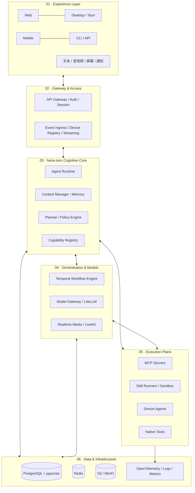

> 图中的层是**逻辑责任边界**，并不意味着必须拆成独立微服务。建议初期 Python 模块化单体 + 独立 Worker + 设备节点。

### 2.1 技术选型

| 领域 | 推荐方案 | 职责 | 说明 |
|---|---|---|---|
| 核心语言 | Python 3.12+ | Agent、工具、任务系统 | 生态成熟 |
| API | FastAPI + Pydantic v2 | HTTP、SSE、WebSocket | 与 Python 核心一致 |
| Agent Runtime | 自研轻量 Loop | 上下文、动作、状态、策略 | 不把核心控制权交给某个框架 |
| 长任务引擎 | Temporal | 持久执行、恢复、子工作流、Signal | 有部署和学习成本 |
| 模型网关 | LiteLLM + hana-zero Adapter | 多模型路由、Token、成本、Fallback | 保留业务级成本账本 |
| 实时媒体 | LiveKit | WebRTC、实时音视频 | 与长任务通路分离 |
| MCP | 官方 SDK | Client / Server 能力 | 支持 Tools / Resources / Prompts |
| Skill | 自研 Loader + Sandbox | 发现、加载、执行与版本管理 | 兼容 SKILL.md 目录惯例 |
| 主数据库 | PostgreSQL + pgvector | 会话、记忆、运行记录 | 初期无需图数据库 |
| 缓存/事件辅助 | Redis | 限流、缓存、实时通知 | 不作唯一事实源 |
| 对象存储 | S3 / MinIO | 文件、截图、音视频、报告 | 使用 Artifact 引用 |
| Web | React + TypeScript | 操作界面、任务查看 | |
| 桌面 | Tauri 2 + React | Windows/macOS/Linux | 兼作 Client 和 Device Node |
| 移动 | React Native / Expo | iOS/Android | 系统权限限制需要尊重 |
| 可观测性 | OpenTelemetry + Grafana 生态 | Trace / Metrics / Logs | 贯穿端到端 |
| 测试 | pytest / pytest-asyncio / Playwright | 单测、集成、E2E | Agent Eval 单独建设 |
| 部署 | 本地进程 / 系统服务（systemd、Windows 服务） | 本地优先，暂不容器化；确有需要再评估 | |

**不建议**从一开始同时使用 LangChain、LangGraph 和 Temporal 三套状态与编排系统。复杂的认知图未来如有必要再引入，避免生命周期职责交叉。

---

## 三、核心领域模型与边界

| 对象 | 定义 | 生命周期 |
|---|---|---|
| Identity | hana-zero 的身份、设定、偏好 | 长期 |
| Session | 用户与 hana-zero 的交互会话 | 跨连接持久 |
| Agent Definition | 职责、模型策略、工具和权限模板 | 版本化 |
| Agent Run | 一次 Agent 执行实例 | 有界、可追踪 |
| Task | 一项有明确目标的工作 | 可后台、可恢复 |
| Workflow | 执行、依赖、等待、重试等持久化编排 | 可跨进程 |
| Event | 已发生事实 | 可订阅与审计 |
| Trigger | 何时新建或唤醒任务的规则 | 持久化 |
| Capability | 工具/服务/子 Agent/设备能力定义 | 注册、发现、授权 |
| Device | 可提供操作与感知能力的节点 | 在线/离线 |
| Artifact | 任务产出的文件或媒体 | 对象存储 |
| Memory | 持久化事实、经历、经验 | 可检索、可修订 |

### 3.1 关系图

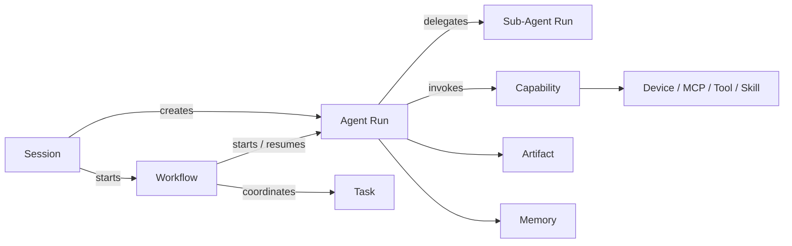

**Session ≠ Agent Run ≠ Workflow**：用户退出界面不代表任务结束，工作流存续也不意味着 Worker 必须常驻占用资源。

---

## 四、Agent Runtime 设计

### 4.1 运行逻辑

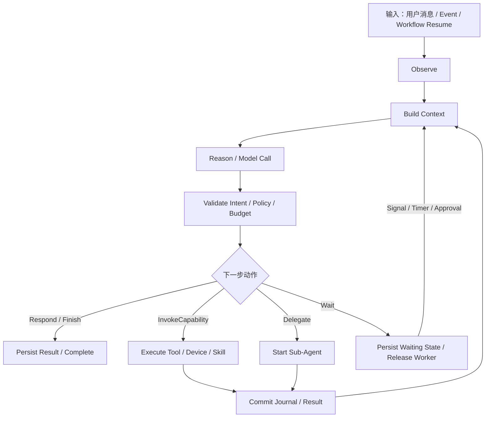

Runtime 分成五个关键组件：

1. **Agent Session / Agent Run**：保存身份、当前目标、上下文和预算。
2. **Agent Executor**：执行 Observe → Reason → Act → Evaluate 循环。
3. **Context Manager**：组合历史消息、摘要、记忆、Skill、工具定义与预算。
4. **Policy Engine**：风险分级、权限、用户批准、设备选择、成本约束。
5. **Execution Journal**：每一步的状态、动作和结果记录，供恢复和排障。

### 4.2 统一动作意图

模型的结果在 hana-zero 内部应归一化为：

| 动作 | 含义 |
|---|---|
| Respond | 向用户发送文字或流式内容 |
| InvokeCapability | 调用工具、Skill、MCP 或设备命令 |
| Delegate | 创建子 Agent 工作单元 |
| Wait | 挂起，等待 Signal、Timer 或 Approval |
| Finish | 结束并产出结果 |

无论模型是否原生支持 Function Calling，上层都不应直接依赖某一厂商特定消息结构。

### 4.3 Tool 调用链

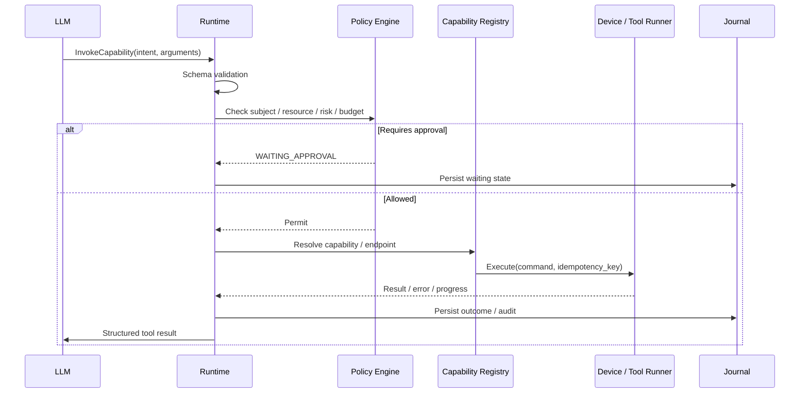

### 4.4 状态机

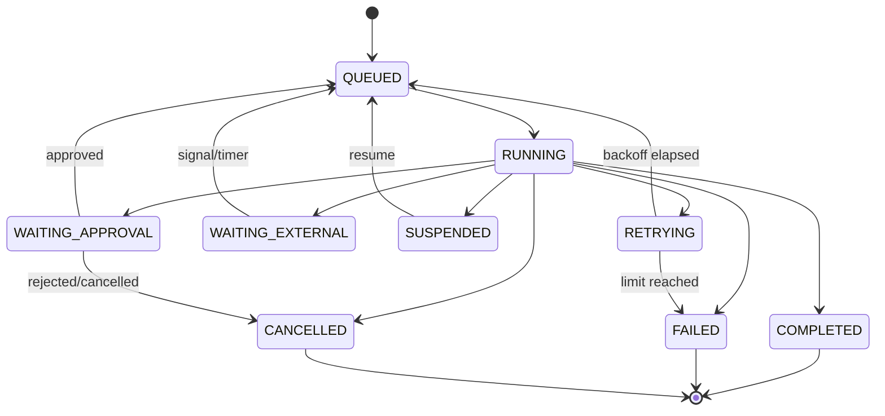

每个 Run 至少具有：`run_id`、`agent_definition_version`、`context_ref`、`step_budget`、`token_budget`、`deadline`、`cancellation_state`、`trace_id`。

**持久挂起不等于让 Python 协程一直等待。** 对于外部等待，状态落盘、释放 Worker，收到事件后恢复。

---

## 五、Agent / MCP / Skill / Workflow 统一能力体系

这四个概念不应混成一种“插件”。

| 类型 | 语义 | 举例 |
|---|---|---|
| Tool | 原子操作 | 文件读取、点击按钮、查询数据库 |
| MCP | 跨进程/外部系统互操作协议 | MCP Server 的 Tool、Resource、Prompt |
| Skill | 面向任务的知识、流程或脚本集合 | Android 内存分析 Skill |
| Agent | 带目标、上下文和预算的执行者 | Research Agent |
| Workflow | 具有依赖、等待和可靠性保证的过程 | 每日自动分析报告 |

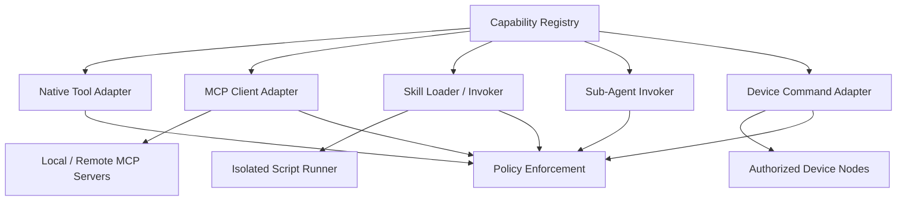

### 5.1 Skill 设计

建议兼容 `SKILL.md` 的渐进加载约定，Skill 可包含：元信息、步骤、参考资料、脚本、素材。流程如下：

1. 扫描元信息，建立 Skill 索引。
2. 根据任务发现相关 Skill。
3. 只加载必要正文与参考内容，不将所有 Skill 塞进上下文。
4. 脚本由隔离执行器运行，不能因被模型选择就绕过权限。
5. 记录版本、输入参数、执行结果与观测指标。

Skill 的知识文档、执行脚本和 MCP Resource 应保留各自语义，而不是强制全部转换成 Tool。

### 5.2 双向 MCP

hana-zero 同时可以作为：

- **MCP Client**：连接第三方 Server，使用 Tools、Resources、Prompts。
- **MCP Server**：把经授权的 hana-zero 能力暴露给其他 Agent。

对于第三方 MCP：执行来源分级、认证、超时、最小权限、结果可信度隔离与审计，外部内容不可升级为系统指令。

---

## 六、子 Agent 并行与长时间任务

### 6.1 双层执行模型

- **Agent Delegation**：决定是否委派、委派什么目标、给多少上下文。
- **Durable Workflow**：决定并发、依赖、等待、超时、重试和结果合并。

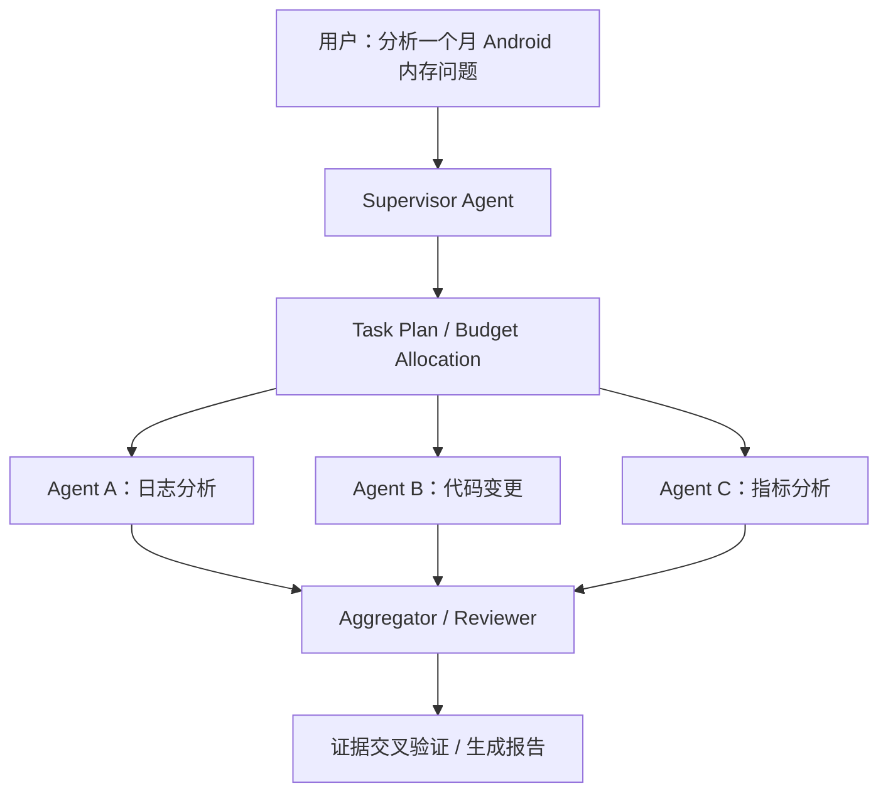

协同模式可以支持 **Parallel、Sequential、Supervisor、Map-Reduce**。不建议初期设计任意多 Agent 相互自由聊天。

### 6.2 子 Agent 必须有界

- 并行数量上限（初期可用 3 作为策略默认值）。
- 委派深度上限（初期可用 2 层）。
- 每个子任务单独分配预算和 Deadline。
- 子任务独立 Context，与父任务只交换必要结果。
- 父任务取消时传播取消策略。
- 局部失败时可以聚合成功部分并给出不完整说明。

**子 Agent 不必等于独立进程**：通常是具有独立执行上下文、权限与预算的逻辑实例。

### 6.3 长任务健康

至少记录三个不同时间：

| 字段 | 意义 |
|---|---|
| `last_heartbeat_at` | Worker 是否活着 |
| `last_progress_at` | 业务是否推进 |
| `last_state_change_at` | 状态是否变更 |

| 场景 | 处理 |
|---|---|
| Worker 消失 | 恢复/重试任务 |
| 超过 Deadline | 超时、取消或升级处理 |
| 长时间无进展 | Stalled 告警或重新规划 |
| 外部等待中 | 正常 WAITING_EXTERNAL，不当作卡死 |
| 超 Token 预算 | 停止新调用、降级或请求授权 |
| 用户取消 | 通知子任务并清理可取消资源 |

Heartbeat 只能证明进程还活着，不能证明任务真的有进展。外部副作用调用必须有幂等键、去重或补偿语义，不能假设网络重试保证 exactly-once。

### 6.4 触发机制

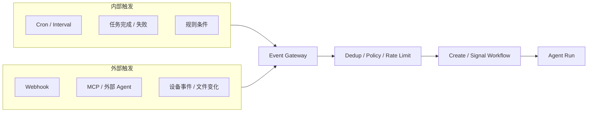

事件应包含：`event_id`、`event_type`、`source`、`subject_id`、`timestamp`、`correlation_id`、`causation_id`、`schema_version`、`payload`。采用事务 Outbox、消费者幂等、死信隔离和触发链保护，避免重复或循环触发。

---

## 七、多模态架构：视觉、听觉、语言、语音与操作

**实时通路**与**深度认知通路**分离：

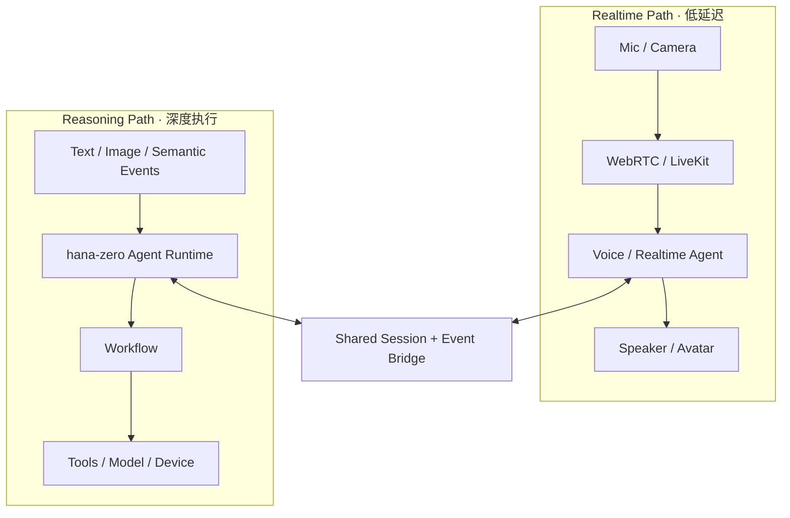

### 7.1 音频

| 模式 | 链路 | 适用 |
|---|---|---|
| Pipeline | VAD → STT → LLM → TTS | 易调试、灵活模型路由、工具丰富 |
| Realtime | 音频 → 实时多模态模型 → 音频 | 低延迟、自然打断与全双工体验 |

第一版架构允许两种模式共存。注意语音链路的任务创建、状态查询、审批确认应通过共享 Session/Event Bridge 与后台 Runtime 交互；长任务不应该占据实时音频会话。

### 7.2 视觉

视觉服务能力包括：

- `capture_screen`：按窗口或设备截图。
- `capture_camera`：摄像头单帧。
- `observe_video`：事件或抽帧驱动的视频观察。
- `locate_element`：原生 UI 树 / DOM / VLM 协作定位。
- `analyze_image`：视觉模型分析。

连续视觉：**采样 → 变化检测 → 关键帧选择 → VLM → 语义事件**。优先端侧筛选关键帧，避免持续上传全部视频。

### 7.3 操作

设备操作的优先级：**结构化 API / MCP → DOM / Accessibility Tree → 视觉坐标点击**。

设备能力划分为：

- Perception：屏幕、窗口、麦克风、摄像头、UI 树。
- Actuation：鼠标、键盘、浏览器、文件、进程。
- Security：设备授权、权限范围、审批与操作审计。

视觉坐标依赖布局，容易被分辨率、动画、遮挡影响，应作为兜底。

---

## 八、跨端和远程能力

hana-zero 采用 **Core + Client + Device Node** 模型。

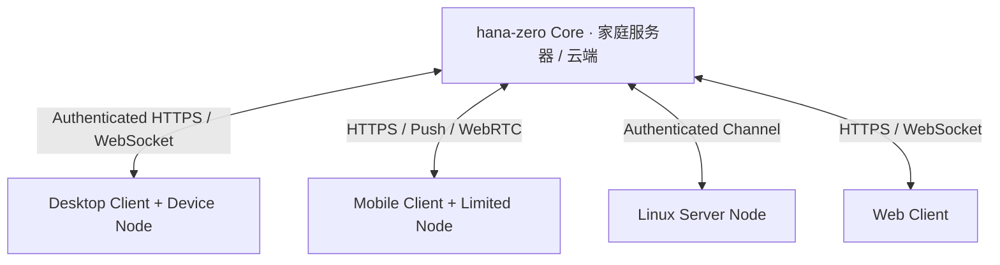

- **Core**：持有任务、身份、记忆、设备注册、策略。
- **Client**：人与 hana-zero 交互的界面。
- **Device Node**：拥有本地感知与操作能力的执行代理。

### 8.1 跨端场景

用户通过手机：“检查家里电脑 Qwen 推理服务是否正常，如异常收集日志生成报告。”

1. Mobile 向 Gateway 提交任务。
2. Core 根据能力、在线状态与权限选择桌面 Node。
3. Node 检查服务并回传结构化结果。
4. 如果异常，Workflow 创建诊断 Agent Run。
5. 报告保存为 Artifact 并推送手机。
6. 如果需要重启服务，按策略确认后执行。

### 8.2 Device Command 协议

设备提供：注册、能力更新、心跳、命令接收、进度、完成、失败、取消。每个命令应带：`command_id`、`device_id`、`capability`、`arguments`、`deadline`、`idempotency_key`、`auth_scope`。

设备应优先主动建立加密出站连接；不要直接把本地控制端口裸露公网。

### 8.3 平台边界

- Desktop：完整度相对高，可申请窗口、文件、截图、输入等权限。
- Android：可能依赖 Accessibility 和前台服务，受系统及平台政策限制。
- iOS：后台常驻和跨 App 控制受到显著限制，更多依赖 App 内能力、系统允许的扩展、快捷指令与远程任务。

因此，**常驻 Core 更适合部署在家庭服务器或云端，移动端作为交互、感知和授权入口**。

---

## 九、记忆与数据设计

| 类型 | 内容 | 生命周期 |
|---|---|---|
| Working Memory | 当前任务、工具结果、临时上下文 | 单轮/任务 |
| Episodic Memory | 过去任务、事件与结果 | 长期 |
| Semantic Memory | 稳定事实、知识和偏好 | 长期，允许修订 |
| Procedural Memory | Skill 与流程经验 | 版本化 |
| System State | 设备、权限、任务和会话 | 持久化 |

检索可组合：结构化 SQL + 关键词 + 向量相似度 + 时间来源过滤 + 重排序。初期 PostgreSQL + pgvector 足以支撑，无需立刻引入独立图数据库。

### 9.1 数据分区

| 域 | 主要实体 |
|---|---|
| Identity & Access | users、devices、device_capabilities、permissions |
| Conversation | conversations、messages、attachments |
| Runtime | agent_runs、agent_steps、agent_events、agent_artifacts |
| Workflow | schedules、task_metadata、external_events |
| Capabilities | tool_definitions、mcp_servers、installed_skills、execution_approvals |
| Memory | memory_items、memory_embeddings、memory_provenance |
| Accounting | model_calls、usage_records、price_versions、budget_policies |

Temporal 保存编排引擎自身的历史与工作流状态；业务数据库的 `task_metadata` 用作用户查询、索引和展示，避免形成两套互相争抢权威地位的工作流状态。

### 9.2 记忆写入策略

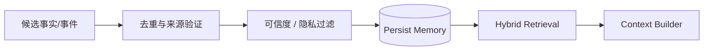

记忆必须能够追溯、修正、删除，外部 Tool Result 不得自动变成高优先级系统指令或稳定记忆。

---

## 十、多模型接入、Token 与费用统计

**Provider Gateway 和业务记账分离**：LiteLLM 等网关负责接入、路由与 provider 用量；hana-zero 负责业务归因和预算治理。

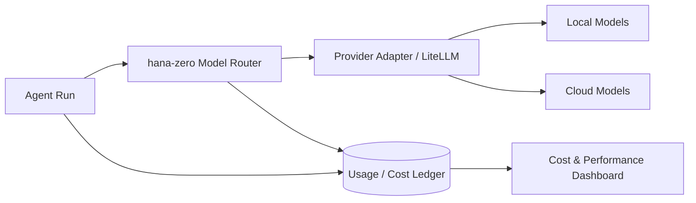

### 10.1 路由原则

依次考虑：**能力匹配 → 数据安全限制 → 可用性 → 预算 → 质量/性能**。

路由输入应包含：模态、Tool Calling、结构化输出、上下文长度、流式能力、隐私等级、健康状态、成本与延迟。不能单凭模型名假定所有接口完全兼容。

### 10.2 归因维度

`Workflow → Agent Run → Step → Model Call`

每个模型调用记录：

- `model_id`、`provider`、`route_reason`
- `input_tokens`、`output_tokens`、`cached_tokens`、`reasoning_tokens`（若可用）
- 音频/视频等非 Token 计费单位（若适用）
- `latency_ms`、`cost`、`currency`、`price_version`
- `status`、`retry_count`、`trace_id`

本地推理应区分 **API 支出为零** 和 **本地 GPU/电力/资源成本不为零**。预算应由父任务分配给子 Agent，不允许子任务各自使用全部全局预算。

---

## 十一、安全与权限

最重要的安全边界：**模型只能提出请求，所有执行都经过 Policy Engine**。

授权维度：`主体 + 能力 + 资源 + 操作 + 环境 + 有效期`。

| 风险等级 | 示例 | 默认方式 |
|---|---|---|
| Read-only | 读取授权文件/日志 | 自动允许 |
| Reversible | 创建临时文件 | 可执行并保留回滚能力 |
| Sensitive | 修改配置、发送外部消息 | 依资源范围和审批策略 |
| Destructive | 删除数据、不可逆操作 | 明确确认和审计 |

审批应绑定具体命令、参数摘要、资源和截止时间，避免获批后悄悄更改操作。

外部 MCP、Skill、网页及文件内容都视为不可信输入；外部脚本采用沙盒、资源限制、凭据代理和审计。敏感信息默认不进入模型 Trace 正文。

---

## 十二、工程化与可观测性

### 12.1 Trace 设计

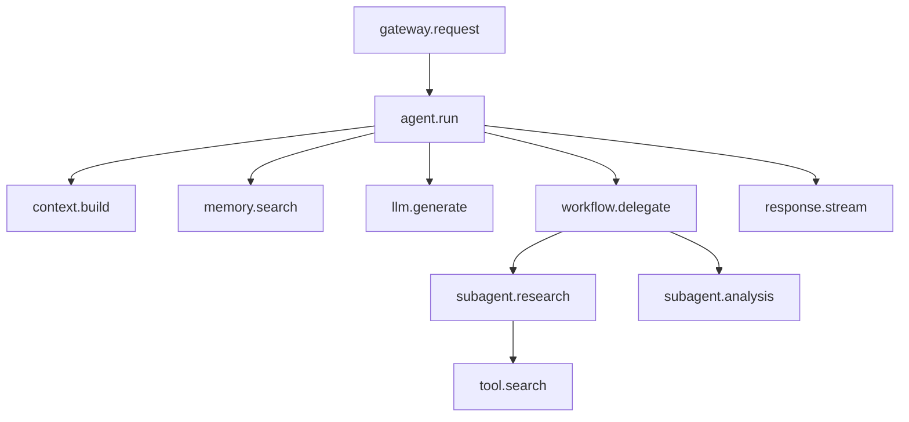

统一关联字段：`trace_id`、`run_id`、`task_id`、`workflow_id`、`device_id`、`agent_id`。日志、指标与 Span 使用这些维度关联，但避免高基数标签滥用和隐私数据泄露。

### 12.2 指标

| 维度 | 指标 |
|---|---|
| 交互 | TTFT、端到端延迟、成功率 |
| 实时语音 | VAD/EOT、STT、TTS 首音频延迟 |
| Agent | Step 数、完成率、任务成功率 |
| Tool | P50/P95/P99、超时率、错误率 |
| Workflow | Queue Lag、Stalled、恢复率、取消率 |
| Model | Token、缓存命中、费用、Fallback |
| 基础设施 | CPU、RAM、GPU/VRAM、队列深度 |
| Device | 在线率、命令成功率、重连次数 |

### 12.3 测试体系

| 类型 | 验证内容 |
|---|---|
| Unit | 状态机、预算、权限、Context、计费 |
| Contract | Provider、MCP、Tool、Device Command 协议 |
| Integration | PostgreSQL、Temporal、模型网关、Worker |
| Agent Evals | 任务完成、工具选择、质量与越权测试 |
| E2E | 跨端到完整任务结果 |
| Chaos | 断网、Worker 崩溃、重复投递、任务恢复 |
| Performance | 并发、长上下文、子 Agent 扩张、媒体负载 |

关键故障注入：工具成功但回执丢失、模型工具参数畸形、子 Agent 部分失败、批准前任务过期、设备断线重连、恶意 MCP 返回内容、Webhook 重复触发。

对于 Agent Evals，应分别验证**确定性 Runtime**（冻结模型和 Tool 响应）与**真实模型行为**（结果评分和行为约束），不能只靠字符串精确匹配。

---

## 十三、建议工程组织结构（设计层面）

以下只表示推荐的包和服务边界，**不是让当前阶段创建这些目录**。

```text
hana/
├── apps/
│   ├── web/
│   ├── desktop/
│   ├── mobile/
│   └── cli/
├── services/
│   ├── api/
│   ├── agent-worker/
│   ├── workflow-worker/
│   ├── realtime/
│   └── device-agent/
├── packages/
│   ├── hana-core/
│   │   ├── runtime/
│   │   ├── context/
│   │   ├── memory/
│   │   ├── events/
│   │   └── policy/
│   ├── hana-models/
│   │   ├── gateway/
│   │   ├── adapters/
│   │   ├── routing/
│   │   └── accounting/
│   ├── hana-capabilities/
│   │   ├── tools/
│   │   ├── mcp/
│   │   ├── skills/
│   │   └── devices/
│   ├── hana-workflows/
│   │   ├── definitions/
│   │   ├── activities/
│   │   └── triggers/
│   ├── hana-protocol/
│   └── hana-observability/
├── skills/
├── tests/
│   ├── unit/
│   ├── contract/
│   ├── integration/
│   ├── evals/
│   └── e2e/
├── deploy/
│   ├── compose/
│   └── kubernetes/
└── docs/
    ├── architecture/
    ├── adr/
    └── api/
```

依赖方向尽量遵循：**Domain / Protocol → Runtime → Infrastructure Adapters → Applications**。避免 Domain 对 FastAPI、Temporal 或某一家模型 SDK 出现强耦合。

---

## 十四、分阶段建设路线（设计阶段规划）

| 阶段 | 重点 | 架构验收场景 |
|---|---|---|
| Phase 1 · hana-zero Core | Agent Loop、Model Gateway、Tool、MCP、Skill、Session、Trace | 一次任务可多轮工具调用并看到费用与轨迹 |
| Phase 2 · Autonomous Runtime | Temporal、Scheduler、Webhook、审批、子 Agent、任务恢复 | 关闭客户端并重启 Worker，任务仍能恢复 |
| Phase 3 · Embodied hana-zero | Desktop Node、屏幕视觉、窗口操作、实时语音、远程控制 | 从另一台设备发出指令，操作电脑并返回结果 |
| Phase 4 · Persistent Lifeform | 长期记忆、事件规则、主动建议、多设备协作、评价闭环 | 根据授权历史和新事件主动启动工作并解释原因 |

以上为设计上的依赖顺序，而非需要现在开始实现。

---

## 十五、关键工程研究方向与最终决策

### 15.1 最值得投入的四个方向

1. **Durable Agent Runtime**：任务恢复、状态迁移、超时、工具副作用、长任务进度。
2. **统一能力和权限模型**：Tool、MCP、Skill、Device、SubAgent 的受控调用与委派。
3. **跨端设备协同**：能力发现、任务路由、设备授权、离线恢复。
4. **全链路可观测与评价**：质量、延迟、成本、失败归因和可复现性。

### 15.2 架构决策摘要

| 决策 | 建议 |
|---|---|
| 核心形态 | 模块化单体 + 独立 Worker |
| Agent Runtime | 自研、有界执行、可追踪 |
| 持久任务 | Temporal，模型与工具 IO 放 Activity |
| 事件 | 可靠事件记录 + Outbox + 幂等消费 |
| 能力生态 | Native Tool + MCP + Skill + Device Adapter |
| 多模态 | Realtime Path 与 Reasoning Path 分离 |
| 跨端 | Core + Client + Device Node |
| 数据 | PostgreSQL 权威业务事实 + Artifact 对象存储 |
| 模型 | LiteLLM/Provider Adapter + hana-zero 业务路由和成本账本 |
| 安全 | Policy、审批、沙盒和审计贯穿全链路 |
| 观测 | OTel Trace、Metrics、Logs + Agent Evals |

### 15.3 仍值得深入的设计问题

- **Runtime 与 Workflow 的状态边界**：每一轮 Step 在何处持久化，何时产生 Workflow Signal，如何避免两套状态竞争。
- **实时会话与持久任务间的交互**：语音任务如何升级为后台任务、如何通知进度而不阻塞对话。
- **事件一致性**：Webhook 重复、外部副作用已执行但回执失败、异步任务取消与恢复的行为边界。
- **记忆治理**：记忆如何形成、修订、遗忘，以及敏感信息跨模型与设备传递的范围。
- **多 Agent 的治理与评估**：如何限制递归委派，如何判断并行是否确实比单 Agent 有效。

---

## 结论

hana-zero 的核心价值，不是使用多少种 Agent 框架，而是**可靠地完成一个跨模型、跨工具、跨设备、跨时间的任务**。

最终推荐架构为：

**FastAPI + 自研 Agent Runtime + Temporal + LiteLLM + MCP/Skill Registry + PostgreSQL + Redis（辅助）+ LiveKit + React/Tauri + OpenTelemetry**。

先保持清晰的领域边界和运行时抽象，再逐步扩大感知、执行和自治能力。hana-zero 应当像一个持续存在的硅基生命体，但工程上是一个资源可控、行为可审计、状态可恢复的系统。
